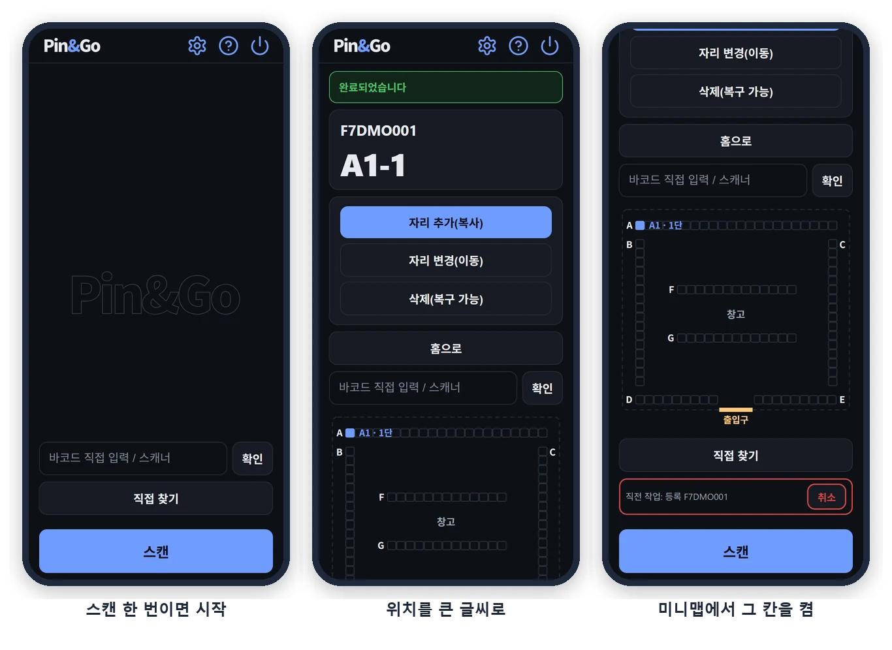
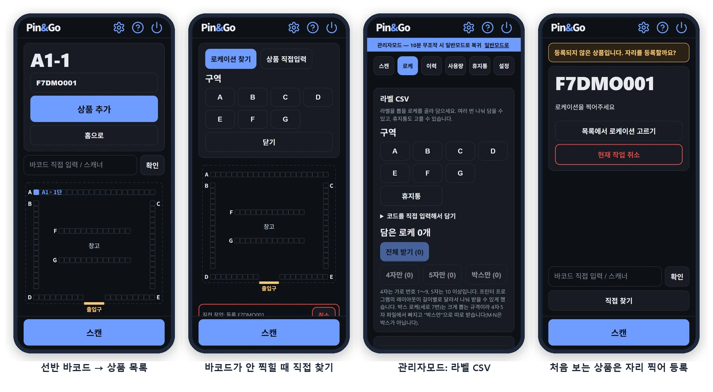
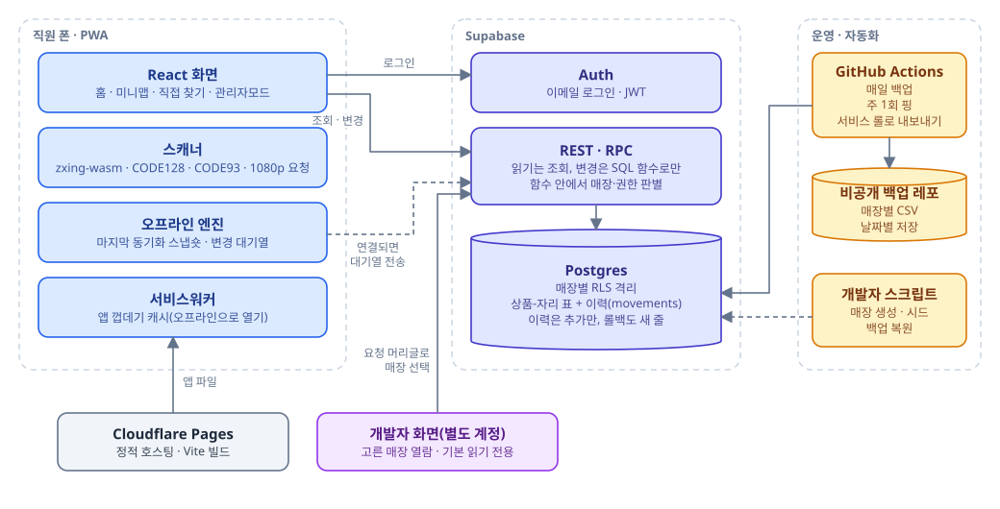
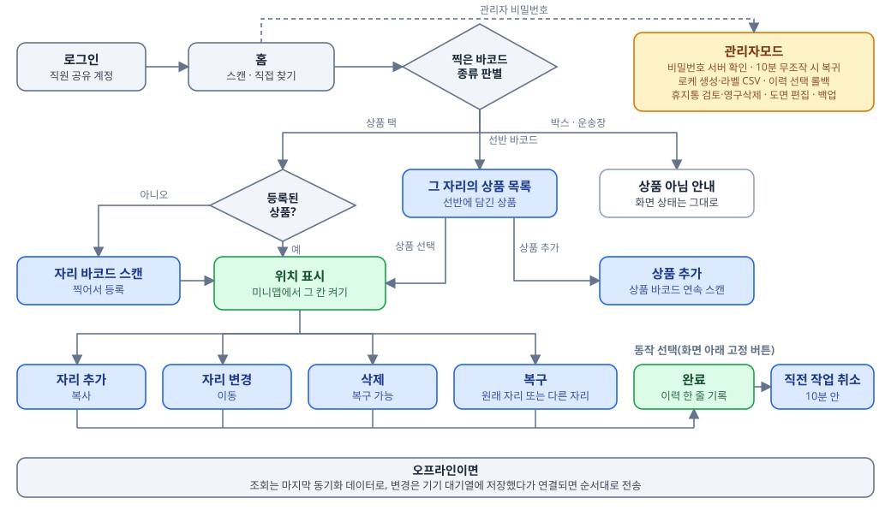
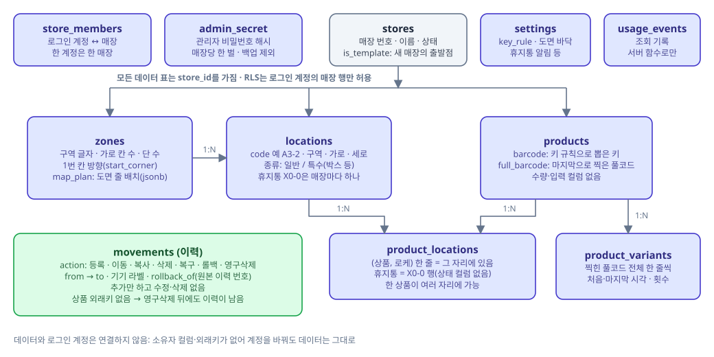
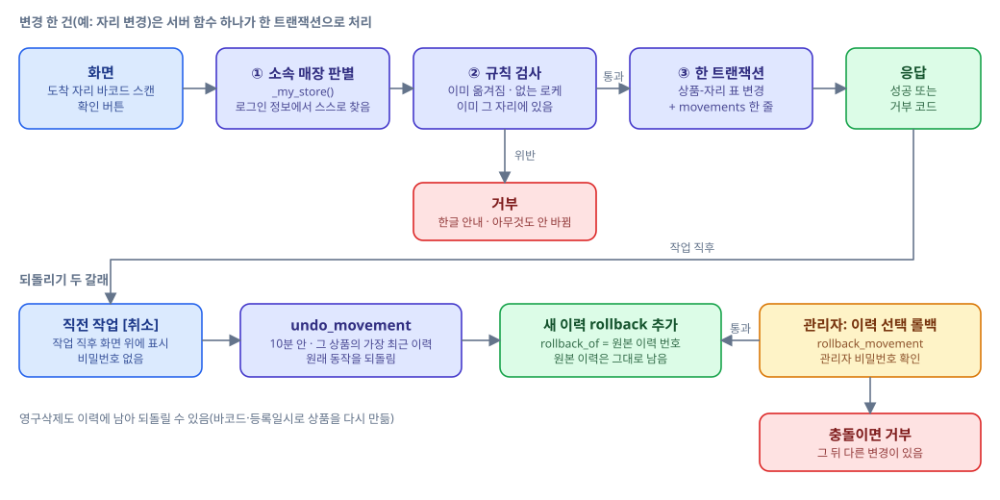
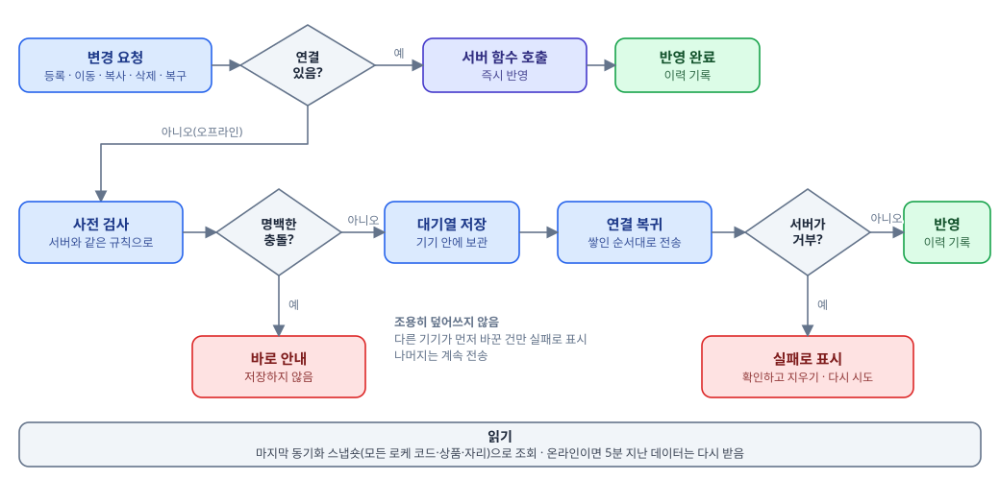
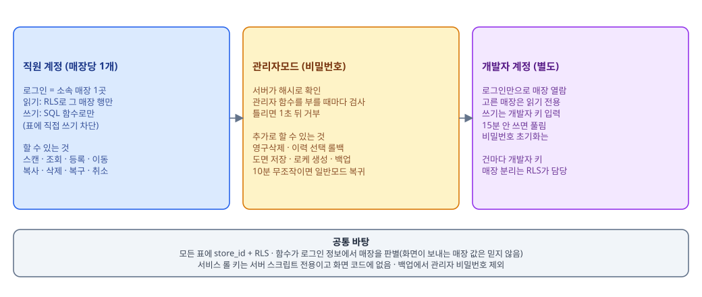

# Pin&Go

**상품 바코드를 스캔하면 창고 선반 위치(로케이션)를 알려주는 웹 서비스(PWA)**

<p align="center">
  
</p>

| | |
|---|---|
| **한 줄 소개** | 백룸·소형 창고에서 "이 상품이 어느 칸에 있지?"를 폰 카메라 스캔 한 번으로 찾는 현장용 도구 |
| **상태** | 소규모 매장 1곳에서 직원 공유 계정으로 실사용 중, 여러 매장을 받는 구조(멀티 테넌트)까지 구현 |
| **역할** | 기획 · 설계 · 구현 · 배포 · 운영 단독(개인 프로젝트) |
| **스택** | React 19 · TypeScript · Vite · PWA / Supabase(Postgres · Auth · RLS · SQL 함수) / zxing-wasm / Cloudflare Pages / GitHub Actions |
| **규모** | 변경 함수 10여 개, 단위·DB 시험 약 1,140건, 매장 여러 곳을 받는 구조 |

> **공개 범위**: 이 저장소에는 README·도식·화면만 있습니다. 실제 매장에서 운영 중인 서비스라 매장 정보 보호를 위해 코드와 스키마는 공개하지 않고, 면접이나 요청 시 매장 정보·사업 자료를 뺀 정리본을 별도 저장소에서 제한적으로 열람하게 합니다. 화면은 일반 기본 도면과 가상 데이터로 촬영했습니다.

---

## 문제와 접근

- **문제**: 본사 차원의 매장별 실재고 관리 지원이 없어 매장 백룸의 *선반 위치*는 관리되지 않는다. 현장은 수기 메모지·기억·엑셀로 버티고, 상품 하나 찾는 데 오래 걸린다(보통 3〜4분, 10분 이상 걸리거나 못 찾는 경우도 있음). 바코드 전산화는 PDA 한 대당 70〜100만 원에 앱 사용료 또는 개발비, 프린터와 바코드 라벨 출력·부착, 상품 바코드 인식 작업까지 필요해 매장이 혼자 해결하기 어렵다.
- **조건**: 사용자는 디지털 기기에 익숙하지 않은 직원 포함. 전용 PDA 없이 직원 폰·공기계로 쓰고, 백룸은 신호가 약하다. 소프트웨어 운영비는 최소여야 한다.
- **접근**
  - 선반 칸마다 바코드 라벨을 붙이고, 상품 바코드를 그 칸에 연결해 둔다.
  - 메뉴 선택 없이 **스캔 버튼 하나**로 시작한다. 어떤 바코드를 찍든 앱이 종류를 판별한다(위치 코드 / 상품 / 상품 아님).
  - 결과는 큰 글씨 위치와 **창고 도면 위 미니맵**으로 보여 준다.

---

## 도입 효과

소규모 매장 1곳(공유 계정, 기기 4대)에서 14일간(11-10〜11-23) 쓴 결과다.

| 구분 | 내용 |
|---|---|
| 사용량(앱 기록) | 조회 277건(첫 주 141건, 둘째 주 136건으로 유지). 스캔 소요시간 중앙값 2.8초 |
| 보통 상품 | 이동 포함 3〜4분 → 핀고 1분 이내(이동 왕복 30초 + 위치 확인·사이즈 찾기까지 30초 이내), 건당 2〜3분 단축 |
| 찾기 어려운 상품 | 10분 이상 단축. 이전에는 10분을 넘겨도 못 찾는 경우가 있었음 |
| 하루 절감(추정) | 건당 2〜3분 × 하루 약 20건 = 40〜60분 이상 |
| 새 상품 위치 표시 | 수기(달력 종이를 잘라 쓰고 테이프로 붙이던 기존 방식) 약 20초 → 핀고 약 7초, 건당 약 13초 단축(선반까지 이동하는 시간은 양쪽 모두 제외) |
| 인력 | 신입·행사 알바는 다른 직원에게 부탁해야 했고 부탁받은 직원도 찾는 시간이 들었음. 이제 누구나 위치를 바로 확인함 |

소요시간은 작업자가 여러 번 직접 잰 값이고, 조회 건수는 앱 기록이다. 핀고의 새 상품 위치 표시 시간은 앱 기록 중앙값(새 상품 스캔 4.2초 + 위치 스캔 2.2초)이다. 절감 추정은 보통 상품 기준이라 어려운 상품과 두 사람이 함께 찾던 시간은 넣지 않았다. 잘못 담는 일을 막은 효과는 아직 수치로 잡지 못했다.

---

## 핵심 기능

<p align="center">
  
</p>

| 영역 | 내용 |
|---|---|
| 조회·등록 | 상품 스캔 → 위치와 미니맵, 처음 보는 상품은 자리를 찍어 등록, 선반 스캔 → 그 자리의 상품 목록 |
| 변경 | 자리 추가(복사) · 자리 변경(이동) · 휴지통으로 · 복구, 직전 작업 10분 안 취소 |
| 못 찍을 때 | 구역 → 가로 → 세로로 직접 찾기, 상품 직접 입력 |
| 오프라인 | 마지막 동기화 데이터로 조회, 변경은 기기 대기열에 쌓았다가 연결되면 자동 반영 |
| 관리자모드 | 로케 일괄 생성, 길이별 라벨 CSV, 이력 선택 롤백, 휴지통 검토·영구삭제, 사용량 통계, 백업, 도면 편집(끌어서 놓기) |
| 여러 매장 | 매장별 데이터 격리, 상품 키 규칙·도면을 매장 설정으로 저장, 새 매장 생성·복원 도구 |
| 운영 | 매일 자동 백업(매장별 CSV), 개발자 계정(매장 열람·문의 응대, 로그인만으로 읽기 전용이고 쓰기는 개발자 키로 15분 동안만) |

---

## 시스템 아키텍처

<p align="center">
  <picture>
    <source media="(prefers-color-scheme: dark)" srcset="docs/readme/diagrams/arch-dark.svg">
    
  </picture>
</p>

- **클라이언트는 서버 없는 PWA**: 화면·스캔·오프라인 엔진이 폰 안에서 돌고, 서비스워커가 앱 껍데기를 캐시한다. 서버 코드를 따로 운영하지 않고 Supabase의 SQL 함수가 그 역할을 한다.
- **쓰기는 함수로만**: 읽기는 RLS가 걸린 표를 직접 조회하고, 변경은 SQL 함수(RPC)만 허용해 규칙 검사와 이력 기록을 한 곳에 모은다.
- **운영 자동화**: GitHub Actions가 매일 매장별 CSV를 별도 비공개 레포에 백업하고, 주 1회 핑으로 무료 플랜의 미접속 정지를 막는다.

---

## 사용자 서비스 흐름

<p align="center">
  <picture>
    <source media="(prefers-color-scheme: dark)" srcset="docs/readme/diagrams/flow-dark.svg">
    
  </picture>
</p>

스캔 판별 규칙(찍힌 문자열 하나로 분기):

| 읽힌 값 | 처리 |
|---|---|
| 위치 코드 패턴(예 `A7-5`, 휴지통 `X0-0`)과 전체 일치 | 위치 화면(그 자리의 상품 목록). DB에 없으면 "등록되지 않은 위치" |
| 숫자만 있거나 11자 미만(박스·운송장 등) | "상품 바코드가 아닙니다"만 안내, 화면 상태 유지 |
| 그 외 | 상품 후보. DB에 있으면 위치 표시, 없으면 등록 유도 |
| 지원하지 않는 형식(QR 등) | "인식할 수 없는 바코드입니다" |

---

## 데이터 구조

<p align="center">
  <picture>
    <source media="(prefers-color-scheme: dark)" srcset="docs/readme/diagrams/er-dark.svg">
    
  </picture>
</p>

- 모든 데이터 표에 `store_id`를 두고 RLS가 로그인 계정의 매장 행만 허용한다.
- 휴지통은 별도 상태 컬럼 없이 `product_locations`의 `X0-0` 행으로 표현한다. 수량·사람이 입력하는 컬럼은 두지 않았다.
- 이력(`movements`)은 추가만 하고, 상품 외래키가 없어 **영구삭제 뒤에도 이력이 남고 그 이력으로 되돌릴 수 있다**.
- 데이터와 로그인 계정은 연결하지 않는다(소유자 컬럼·외래키 없음). 계정을 바꾸거나 지워도 데이터가 사라지지 않게 한 선택이다.

---

## 핵심 설계 결정

### 1. 변경은 한 트랜잭션으로, 되돌리기는 새 이력으로

<p align="center">
  <picture>
    <source media="(prefers-color-scheme: dark)" srcset="docs/readme/diagrams/change-dark.svg">
    
  </picture>
</p>

| 문제 | 선택 | 이유 |
|---|---|---|
| 두 직원이 같은 상품을 동시에 옮김 | 함수 안에서 출발 자리·도착 자리 상태를 검사하고 위반이면 거부 코드 반환 | 먼저 반영된 처리만 확정, 나머지는 한글 안내(조용히 덮어쓰지 않음) |
| 잘못 누른 직후 바로잡기 | 직전 작업 [취소](비밀번호 없음, 작업 후 10분 안 + 그 상품의 가장 최근 이력일 때만) | 현장에서 가장 흔한 실수를 마찰 없이 복구 |
| 며칠 지나서 발견한 오류 | 관리자가 이력을 골라 롤백, **롤백도 이력 한 줄을 더함**(원본 유지) | 이력이 항상 추가만 되어 감사가 가능, 그 사이 다른 변경이 있으면 충돌로 거부 |

### 2. 오프라인에서도 쓰이게

<p align="center">
  <picture>
    <source media="(prefers-color-scheme: dark)" srcset="docs/readme/diagrams/offline-dark.svg">
    
  </picture>
</p>

- 오프라인에서도 **서버와 같은 규칙·같은 오류 코드**로 사전 검사해 명백한 충돌은 저장하지 않고 바로 안내한다.
- 알려진 한계: 대기열로 저장한 변경은 이력에 서버가 받은 시각으로 기록된다(조회 기록은 원래 시각 유지).

### 3. 권한은 세 층, 비밀은 서버에만

<p align="center">
  <picture>
    <source media="(prefers-color-scheme: dark)" srcset="docs/readme/diagrams/access-dark.svg">
    
  </picture>
</p>

- 관리자 비밀번호는 주로 **실수 방지 장치**(영구삭제 같은 되돌리기 어려운 동작 앞의 확인)로 설계했다. 서버가 해시로 확인하고, 5번 연속 틀리면 그 매장의 관리자모드 진입을 잠그며(15분 → 60분 → 24시간), 번호는 진입할 때 한 번만 확인해 15분짜리 임시 확인값으로 바꿔 쓴다.
- 개발자 계정은 매장을 넘나들 수 있는 유일한 통로라서 로그인만으로는 **읽기 전용 트랜잭션**으로만 열린다. 수정하려면 개발자 키를 입력해 서버에서 15분짜리 쓰기 확인값을 받고(쓸 때마다 연장, 안 쓰면 만료, 키는 앱에 남지 않음) 그 안에서만 관리자 동작까지 허용한다. 매장 간 분리는 행 단위 보안(RLS)과 소속 판별 함수가 맡는다.
- 서비스 롤 키는 서버 스크립트 전용이며 화면 코드에 넣지 않는다. 화면이 보내는 매장 값은 믿지 않고 함수가 로그인 정보에서 매장을 판별한다.

### 4. 그 밖의 선택

| 주제 | 선택과 이유 |
|---|---|
| 도면은 데이터 | 미니맵 배치를 코드에 박지 않고 사각형·선·글자로 된 도면 데이터(DB 저장)로 그린다. 매장마다 다른 창고를 같은 코드로 그리고, 도면 편집기로 끌어서 수정한다 |
| 상품 키 규칙 설정화 | 바코드에서 키를 뽑는 규칙(시작 위치·길이)을 매장 설정으로 두고 서버·화면이 같은 규칙을 쓴다. 매장마다 바코드 체계가 달라도 코드를 고치지 않는다 |
| 호스팅 | 무료 호스팅 중 상업 사용 약관을 확인해 Cloudflare Pages를 선택(Vercel 무료는 비상업 전용이라 제외) |
| 백업 | 무료 DB 플랜에 백업이 없어 GitHub Actions 예약 작업으로 매일 CSV를 내보내고, 복원 스크립트와 복원 시험까지 갖춤 |

---

## 검증과 품질

| 구분 | 내용 |
|---|---|
| 단위 시험(Vitest) | 스캔 판별·키 규칙·도면·오프라인 대기열·백업 변환 등 438건 |
| DB 시험(PGlite) | 변경 함수·권한·관리자 비밀번호·**매장 격리**·마이그레이션 이전과 되돌림·개발자 계정 698건. 메모리 안에서 실제 Postgres 문법·RLS를 검증 |
| 시나리오 시험 | 새 매장을 처음부터 만드는 흐름 28건, 새 매장을 운영 매장과 같은 구성으로 바꾸는 리허설 12건, 백업 복원 27건, 시연 데이터 12건 |
| 브라우저 시험 | 스캔·이동·오프라인·PWA·미니맵 등 e2e 스크립트(puppeteer)와, 가짜 서버로 모바일 폭(390px) 화면을 직접 띄워 보는 화면 점검 스크립트(스캔·이동·직접 찾기·관리자·문의·개발자 계정) |
| CI | 타입 검사 + 린트 + 단위 시험 + DB 시험 + 빌드를 한 스크립트(`npm run check`)로 로컬과 CI에서 동일하게 실행 |

> 시험 건수는 2026-11 기준.

**바코드 판독 사전 검증** — 라벨을 붙이기 전에 "폰 카메라로 읽히는가"부터 검증했다.

- CODE128 시험 이미지를 만들어(`tools/gen_barcodes.py`) 브라우저 디코더와 같은 엔진(zxing-cpp)으로 판독 시험(`tools/decode_test.py`). 축소·블러·JPEG·기울임을 흉내 낸 조건에서 칸 1개가 영상에서 약 1.5픽셀 이상이면 읽혔다.
- 0.25mm 칸을 2픽셀로 읽으려면 한 프레임이 담는 종이 폭이 (영상 가로 픽셀 ÷ 8)mm 이하여야 해서 **카메라 영상을 1080p 이상으로 명시 요청**한다.
- 노트북 화면(143ppi)에서는 0.25mm 칸이 1.4픽셀뿐이라 화면 캡처로는 규격 시험이 불가능함을 확인하고, 실제 인쇄물을 폰으로 찍는 시험으로 전환했다.

---

## 만들면서 바꾼 결정

- **"삭제"를 지우기에서 보관으로**: 시스템 자동 삭제 없이 `X0-0`(휴지통)으로 옮기고, 영구삭제는 관리자 비밀번호와 "영구삭제 12개" 문구를 똑같이 치게 한다.
- **적용하지 않은 개선**: 프레임마다 영상을 돌려 읽어 대각선 바코드를 읽는 방안은 합성 시험에서 가짜 판독이 0/600장이었지만 실기기 속도와 이웃 바코드 영향을 확인하지 못해 하지 않기로 했다.

---

## 알려진 한계와 다음 단계

- 아이폰 사파리·홈 화면 앱에서 카메라 1080p 요청이 적용되는지 실기기 확인이 남아 있다.
- 오프라인 대기열 변경의 이력 시각 한계(위 설명).
- 개발자 계정은 로그인 비밀번호 하나가 모든 매장의 읽기 권한이 되는 위험을 감수했다. 길고 고유한 비밀번호, 폰 화면 잠금, 분실 시 비밀번호·개발자 키 교체로 줄이며, 쓰기는 개발자 키로 15분만 켜진다.
- 매장 온보딩 마법사(현재는 개발자가 스크립트로 새 매장을 만든다), 결제 연동은 범위 밖으로 남겨 두었다.

---

## 코드 구조 (요약, 코드는 비공개)

```
src/
├── screens/        # 홈 · 미니맵 · 직접 찾기 · 휴지통 · 관리자(도면 편집 · 로케 생성 · 라벨 · 이력) · 개발자 화면
├── lib/            # 스캔 판별 · 키 규칙 · 도면 계산 · 이력 · 오프라인 엔진(offline/) · API 래퍼 + 단위 시험
├── components/     # 관리자 비밀번호 확인 · 카메라 렌즈 선택 · 동기화 바 등
supabase/
├── schema.sql      # 새 프로젝트용 전체 스키마(여러 번 실행해도 안전)
├── migrations/     # 기존 DB용 순서 파일
└── rollbacks/      # 마이그레이션별 되돌림
tools/              # 시험(PGlite · e2e) · 바코드 시험 이미지 생성/판독 · 백업/복원 · 새 매장 생성
.github/workflows/  # ci · backup(매일) · keepalive(주 1회)
```
